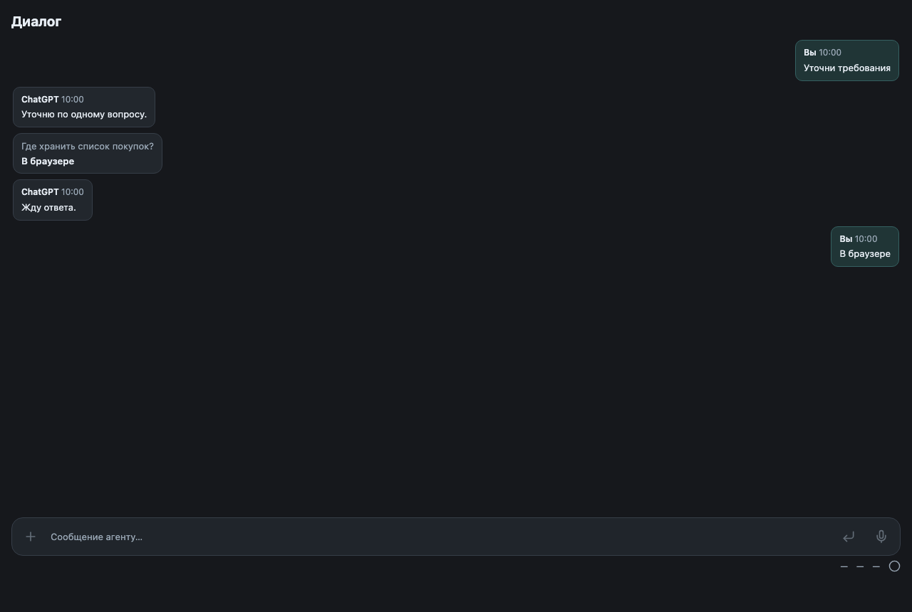
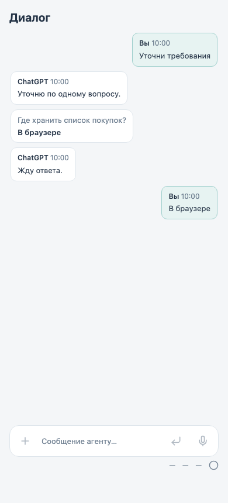

# M34 T003: карточка асинхронного вопроса — design QA

Спецификация — [M34](../../planning/M34-codex-async-answer.md), раздел 2.5. Поверхность — карточка
«Диалог» (`session-chat`): `question-card.js`, `question-model.js`. Вид карточки не менялся: те же
стили `.sc-question*`, что в [M33](../M33/design-qa.md); изменились отправка и закрытое
состояние.

## Что изменилось

- «Отправить» и Ctrl/⌘+Enter шлют `{ attemptId, answers }` маршрутом ответа вопроса, как у
  блокирующего. Строка «Ответ отправлен сообщением» убрана: после отправки — общие фазы
  попытки («Отправляю ответ…», «Ответ отправлен, ждём подтверждения»).
- Закрытая карточка с `answers` из ленты показывает вопрос и выбранный ответ (вариант или свой
  текст), как закрытая блокирующая. Без `answers` — по-прежнему «Ответ дан сообщением».
- Место после своего сообщения, отсутствие метки при пустом заголовке и неизменная строка
  состояния — как в M33.

## Браузерный прогон

15.11.2026, изолированный Chromium (`test/run-browser.mjs`), сценарий
`test/m34-async-answer.browser.js`: dark 1280 (⌘+Enter) и light 390 (Ctrl+Enter) — по 21
проверке, все пройдены; сценарий блокирующей карточки `test/m33-question.browser.js` (dark 1280)
— 26 проверок, пройдены. Ошибок страницы нет, горизонтальной прокрутки нет, сенсорные цели не
меньше 44 px.

| Тема, ширина | Закрытая карточка с ответом |
| --- | --- |
| dark, 1280 |  |
| light, 390 |  |

На снимках ответ виден дважды по смыслу: закрытой карточкой (вопрос и «В браузере») и
сообщением пользователя, которое лента показывает читаемым текстом вместо обёртки (T002).
